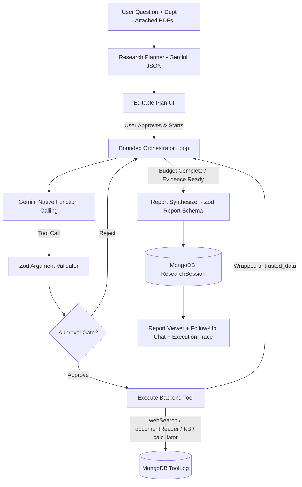

# RESEARCHX AI

**Tagline:** *Research Smarter. Discover Deeper. Think Better.*

**Hackathon Theme:** Theme 4 — Research & Knowledge Agents

---

## 1. Problem Statement

Students, academic researchers, analysts, and product teams spend hours searching fragmented sources across web articles, local PDF papers, and prior notes before they can synthesize reliable conclusions. Existing chatbots either hallucinate citations, hide their reasoning steps, fail to cross-check contradictions between sources, or cannot inspect private PDFs alongside live web evidence.

## 2. Solution Description

**RESEARCHX AI** is a full-stack autonomous research platform built on a **Plan → Execute → Observe → Verify → Synthesize** agent loop. Given a research question and optional PDF documents:

1. **Autonomous Research Planner:** Decomposes the question into sub-questions and generates an editable multi-step plan. Users can edit, add, remove, or reorder steps before approving execution.
2. **Gemini Function Calling Orchestrator:** Uses server-side Google Gemini native function calling (`@google/genai`) inside a bounded loop to dynamically choose tools (`webSearch`, `documentReader`, `knowledgeBaseSearch`, `calculator`), inspect tool outputs, retry transient failures, and check for conflicting claims.
3. **Real-Time Execution Trace:** Streams live step updates and tool logs via Server-Sent Events (SSE) to the UI timeline without exposing private model chain-of-thought.
4. **Structured Cited Reports & Follow-Up Chat:** Synthesizes verified findings into a structured report featuring an executive summary, methodology, confidence-tagged key findings, evidence matrix, explicit conflict comparisons, limitations, open research questions, clickable references, and grounded follow-up chat.

---

## 3. Core Features

- **Autonomous Research Workspace:** Natural language goal input, `Quick / Standard / Deep` depth selector, PDF attachments, editable plan, Pause/Resume/Cancel controls, and optional human-in-the-loop approval before external web searches.
- **4 Real Backend Tools (Zod-Validated):**
  - `webSearch(query, maxResults)` — Live search via Tavily Search API.
  - `documentReader(documentId, query, maxChars)` — Ownership-verified PDF text extraction & passage retrieval.
  - `knowledgeBaseSearch(query, limit)` — Searches the user's prior completed research reports and uploaded PDFs in MongoDB.
  - `calculator(expression)` — Deterministic recursive-descent math parser (never uses `eval`).
- **Dedicated Agent Execution Trace:** Step number, agent action, selected tool, validated input JSON, status (`running`, `success`, `retried`, `failed`, `rejected`), output summary, duration in ms, and retry count.
- **PDF Knowledge Vault:** Drag-and-drop PDF upload (`multer` + `pdf-parse`), magic-byte (`%PDF-`) validation, 10 MB limit, text inspection modal, and owner-isolated deletion.
- **Research History & Follow-Up Chat:** Searchable/filterable history, one-click rerun, Markdown report export, and multi-turn follow-up chat grounded in report citations.
- **Admin Monitoring Dashboard:** Role-based (`/admin`) metrics for active users, sessions, tool usage breakdown (Recharts), and recent failed tool calls.

---

## 4. Agent Architecture



---

## 5. Tool Descriptions & Zod Schemas

| Tool | Purpose | Key Input Schema (Zod) |
| :--- | :--- | :--- |
| `webSearch` | Live Tavily web search returning title, URL, snippet, date | `{ query: string(2..300), maxResults?: int(1..8) }` |
| `documentReader` | Reads relevant passages from an owner-verified uploaded PDF | `{ documentId: ObjectId, query?: string, maxChars?: int(500..18000) }` |
| `knowledgeBaseSearch` | Searches user's saved research reports and PDFs | `{ query: string(2..300), limit?: int(1..10) }` |
| `calculator` | Safe recursive-descent math evaluation (no `eval`) | `{ expression: string matching /^[0-9+\-*/%^().,\s_a-zA-Z]+$/ }` |

---

## 6. Database Schema (MongoDB / Mongoose)

- **`User`**: `name`, `email` (unique), `passwordHash` (`bcrypt`), `role` (`user | admin`), `preferences` (`theme`, `defaultDepth`), `createdAt`.
- **`ResearchSession`**: `userId`, `title`, `question`, `depth`, `subQuestions`, `plan`, `steps`, `status`, `attachedDocumentIds`, `requireApprovalForExternalTools`, `pendingApproval`, `report`, `sources`, `conflicts`, `metrics`, `createdAt`, `updatedAt`.
- **`Document`**: `userId`, `filename`, `extractedText`, `summary`, `fileMetadata` (`mimeType`, `sizeBytes`, `pageCount`, `wordCount`, `sha256`), `createdAt`.
- **`ToolLog`**: `userId`, `researchSessionId`, `stepNumber`, `agentAction`, `toolName`, `input`, `outputSummary`, `status`, `retryCount`, `error`, `duration`, `timestamp`.
- **`ResearchConversation`**: `userId`, `researchSessionId`, `messages` (`role`, `content`, `citations`, `createdAt`).

---

## 7. Project Structure

```text
researchx-ai/
├── .env.example
├── .gitignore
├── render.yaml
├── README.md
├── client/                  # React + Vite + Tailwind CSS + Recharts
│   ├── vercel.json
│   └── src/
│       ├── components/      # Layout, common UI, PlanEditor, ExecutionTrace, ReportViewer, FollowUpChat
│       ├── context/         # AuthContext, ToastContext
│       ├── pages/           # Landing, Login, Register, Dashboard, Workspace, Report, Documents, History, Settings, Admin
│       └── services/        # Axios API client & domain services
└── server/                  # Node.js + Express + Mongoose + Gemini + Tavily
    ├── tests/               # Node native test runner + Supertest + MongoMemoryServer
    └── src/
        ├── agent/           # researchPlanner, researchOrchestrator, reportSynthesizer, sessionRunner
        ├── config/          # env, db
        ├── controllers/     # auth, research, document, admin, health
        ├── middleware/      # auth, role, rateLimit, upload, errorHandler
        ├── models/          # Mongoose schemas
        ├── routes/          # Express routers
        ├── services/        # geminiService, pdfService
        ├── tools/           # webSearch, documentReader, knowledgeBaseSearch, calculator, toolRegistry
        └── validators/      # Zod schemas
```

---

## 8. Local Setup & Execution

### Prerequisites
- Node.js 20+
- MongoDB Atlas URI (or local MongoDB; for offline dev without MongoDB installed, set `USE_IN_MEMORY_DB=true` in `server/.env`)
- Google Gemini API Key (`GEMINI_API_KEY`)
- Tavily Search API Key (`TAVILY_API_KEY`)

### 1. Configure Environment Variables
Copy the example files:
- `server/.env.example` → `server/.env`
- `client/.env.example` → `client/.env`

Fill in `MONGODB_URI`, `JWT_SECRET`, `GEMINI_API_KEY`, and `TAVILY_API_KEY` in `server/.env`.

### 2. Install Dependencies & Run
```bash
# Backend
cd server
npm install
npm run dev

# Frontend (new terminal)
cd client
npm install
npm run dev
```

Open `http://localhost:5173`.

---

## 9. API Documentation

- `GET /api/health` — Database & API key configuration status
- `POST /api/auth/register` — Register account (`name`, `email`, `password`)
- `POST /api/auth/login` — Authenticate & receive JWT
- `GET /api/auth/me` — Current authenticated user profile
- `PATCH /api/auth/me` — Update profile & research preferences
- `POST /api/research/plan` — Generate editable research plan
- `POST /api/research/execute` — Start bounded autonomous execution
- `GET /api/research/history` — List user sessions + dashboard stats
- `GET /api/research/:id` — Fetch session, report, tool logs & conversation
- `GET /api/research/:id/stream` — SSE real-time execution stream
- `POST /api/research/:id/pause` | `resume` | `cancel` | `approve` — Runtime controls
- `DELETE /api/research/:id` — Delete session, tool logs, and chat history
- `POST /api/research/:id/followup` — Ask follow-up question grounded in report
- `POST /api/documents/upload` — Upload & extract PDF (`multipart/form-data`, field `file`)
- `GET /api/documents` — List user PDFs
- `DELETE /api/documents/:id` — Delete user PDF
- `GET /api/admin/overview` — Admin-only monitoring metrics

---

## 10. Testing

Run backend unit & integration tests:
```bash
cd server
npm test
```

Build frontend production bundle:
```bash
cd client
npm run build
```

---

## 11. Security Measures

- **Backend-Only Secrets:** `GEMINI_API_KEY` and `TAVILY_API_KEY` are never exposed to `client/`.
- **Strict Input & Tool Validation:** All request bodies and model-generated tool arguments are validated using **Zod**.
- **Prompt Injection Defense:** PDF and web outputs are sanitized and wrapped inside `<untrusted_data>` delimiters with explicit system instructions to ignore embedded commands.
- **No Arbitrary Code Execution:** The `calculator` tool uses a custom recursive-descent tokenizer/parser—never `eval()` or `new Function()`.
- **Upload Hardening:** Enforces `.pdf` extension, MIME type, `%PDF-` magic bytes, and 10 MB size limit.
- **Auth & Ownership:** `bcrypt` (12 salt rounds), JWT Bearer auth, Helmet headers, CORS origin allowlist, rate limiting, and `userId` scoping on every query.

---

## 12. Deployment Instructions

### Backend (Render)
1. Push repository to GitHub.
2. Create a Render Web Service from `render.yaml` (or set root directory to `server`, build `npm install`, start `npm start`).
3. Add environment variables: `MONGODB_URI`, `JWT_SECRET`, `GEMINI_API_KEY`, `TAVILY_API_KEY`, `CLIENT_URL` (your Vercel URL).

### Frontend (Vercel)
1. Import repository in Vercel with Root Directory set to `client`.
2. Add environment variable: `VITE_API_URL=https://your-render-backend.onrender.com/api`.
3. `client/vercel.json` handles SPA client-side routing automatically.

---

## 13. Demo Workflow (3–5 Minutes)

1. Register/Log in at `/register` → redirects to Dashboard.
2. Upload a PDF document in **Documents (PDF)** (or directly inside the Workspace).
3. Open **Research Workspace**, enter a question (e.g., *"Compare sodium-ion vs lithium-ion grid storage costs and cite evidence from my uploaded PDF and web sources"*), select `Standard` depth, attach the PDF, and click **Generate Research Plan**.
4. Edit/reorder a step in the **Editable Research Plan**, then click **Approve & Start Research**.
5. Inspect the live **Agent Execution Trace** showing `webSearch`, `documentReader`, `knowledgeBaseSearch`, and `calculator` tool calls, inputs, durations, and observations.
6. Open the **Structured Research Report**, review conflicting claims, evidence matrix, and clickable references, and ask a **Follow-Up Question**.
7. Visit **Research History** to rerun or manage past sessions.

---

## 14. Known Limitations

- Requires valid `GEMINI_API_KEY` and `TAVILY_API_KEY` environment variables for live AI planning/synthesis and live web search; if missing, the backend returns explicit `503` configuration errors rather than fabricating data.
- Scanned image-only PDFs without an embedded text layer cannot be extracted without external OCR.
- Real-time pause/cancel/SSE state is managed in-memory per backend instance; multi-instance horizontal scaling would require a Redis pub/sub adapter.
